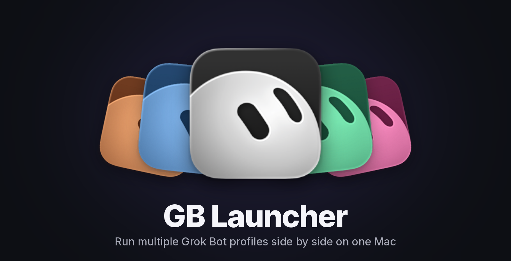

<p align="center"></p>

# GB Launcher: run multiple Grok Bot accounts at the same time on one Mac

**GB Launcher** (`gbp`) lets you run multiple Grok Bot instances side by side on one Mac, each signed in to a different account. Open a second Grok Bot window for work, a third for personal, and tell them apart by a colored, numbered badge. Multi-account Grok Bot without a second computer, and Grok Bot itself is never modified.

> **Unofficial.** Not affiliated with or supported by the makers of Grok Bot. It relies on undocumented app behavior that a Grok Bot update could break. Use at your own risk.

**Requirements:** macOS 12+, Grok Bot installed in `/Applications`, and Xcode Command Line Tools (run `xcode-select --install` if you don't have them).

## Install

Copy and paste this whole block into Terminal. It's safe to run again.

```bash
[ -d ~/gb-launcher ] || git clone https://github.com/paulpierre/gb-launcher.git ~/gb-launcher
~/gb-launcher/launcher/scripts/build.sh
mkdir -p ~/.local/bin
ln -sf ~/gb-launcher/launcher/bin/gbp ~/.local/bin/gbp
grep -qs 'HOME/.local/bin' ~/.zshrc || echo 'export PATH="$HOME/.local/bin:$PATH"' >> ~/.zshrc
export PATH="$HOME/.local/bin:$PATH"
gbp help
```

## Quick start

Make a second profile and open it:

```bash
gbp new
gbp 2
```

`gbp new` creates "Profile 2" with the next number and its own color, with no questions asked. `gbp 2` opens it so you can sign in with your second account. Run `gbp new` again for a third.

Add a double-clickable shortcut for every profile to your Desktop:

```bash
gbp shortcut --all
```

Any time after that, run `gbp` on its own to pick a profile from a menu.

**First sign-in tip:** quit your normal Grok Bot before signing in to a new profile for the first time, because sign-in links open in the default instance. [Details](docs/troubleshooting.md#first-sign-in-of-a-new-profile).

## Commands

| Command | What it does |
|---|---|
| `gbp` | Pick a profile and launch it |
| `gbp new [name]` | New profile with smart defaults (`-i` to choose everything yourself) |
| `gbp <profile>` | Launch a profile, or bring it to the front |
| `gbp list` | All profiles and whether they're running |
| `gbp edit <profile>` | Change name, number, color, icon or border |
| `gbp quit <profile>` | Quit only that profile |
| `gbp shortcut <profile>` | Double-clickable launcher app |
| `gbp uninstall` | Remove GB Launcher (asks first) |
| `gbp help <command>` | Help for any command |

## Uninstall

```bash
gbp uninstall
```

Your profiles and their sign-ins are kept unless you answer yes when it asks. [Details and flags](docs/troubleshooting.md#uninstall).

## More

* [Docs](docs/README.md): full usage, how it works, troubleshooting, uninstall
* [Contributing](CONTRIBUTING.md) · [Security](SECURITY.md) · [License (MIT)](LICENSE)
